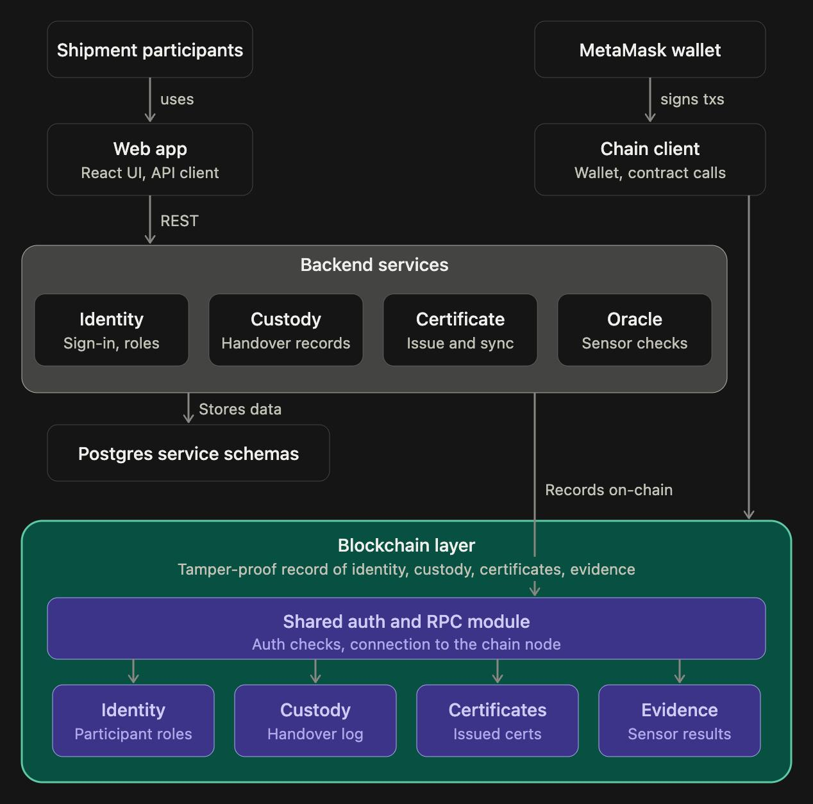

# ColdChainSG

A prototype for tracking chilled food shipments through Singapore's cold chain. It issues tamper-evident quality certificates at each custody step and acts as a neutral evidence layer: **it never moves money**.

DBA5102 Blockchain course project. Original build brief: [docs/brief.md](docs/brief.md). Design decisions, including where the build departs from the brief: [docs/decisions.md](docs/decisions.md). Live demo run sheet: [docs/demo-script.md](docs/demo-script.md).

## Architecture



How the diagram maps to the code:

| In the diagram | In the repo |
| --- | --- |
| Web app | `frontend/` (React + Vite). Calls the services over REST. |
| Chain client / MetaMask | The web app's `frontend/src/lib/chain.ts`. Participants sign their own custody, ruling, decision and acknowledgement transactions in MetaMask. |
| Backend services | `services/identity-service`, `custody-service`, `certificate-service`, `oracle-service`. Each stores its off-chain data in its own Postgres schema. |
| Shared auth and RPC module | `services/common/`: Sign-In with Ethereum sessions, role lookups and the connection to the chain node. It runs in the backend (off-chain) and is shared by all four services. |
| Blockchain layer: Identity | `contracts/contracts/ParticipantRegistry.sol`: wallets, roles, system pause |
| Blockchain layer: Custody | `contracts/contracts/ShipmentCustody.sol`: containers, batches, two-step handovers with signed quality checks, the split |
| Blockchain layer: Certificates | `contracts/contracts/CertificateRegistry.sol`: stage flags, claims, QA rulings and decisions, certificates, acknowledgement |
| Blockchain layer: Evidence | `contracts/contracts/SensorOracle.sol`: sensor registrations, sensor-log fingerprints and per-leg summaries |

On-chain: wallets and roles, custody handovers and both parties' signed checks, sensor-log fingerprints and summaries, claims, rulings, decisions and certificates. Off-chain (Postgres): organisation details, shipment descriptions, spot readings, issue reports, notes and the raw sensor logs. Their fingerprints are recorded on-chain, so any edit is detectable.

## Build status

| Slice | Status |
| --- | --- |
| 1. ParticipantRegistry + wallet login / onboarding | ✅ contract + Identity Service, tested |
| 2. ShipmentCustody + handovers | ✅ contract + Custody Service, tested |
| 3. SensorOracle + CSV replay | ✅ contract + Oracle Service + demo CSVs, tested |
| 4. CertificateRegistry + certificate lifecycle | ✅ contract + Certificate Service, tested |
| 5. Frontend dashboards | ✅ all roles + admin demo control, browser-tested |
| 6. Landing page polish | ✅ animated hero, problem, how it works, impact (illustrative) |

## Prerequisites

- Node 20+ (developed on Node 26)
- Postgres 16.
  `brew install postgresql@16`, set `port = 5433` in `/opt/homebrew/var/postgresql@16/postgresql.conf`, `brew services start postgresql@16`, `createdb -p 5433 coldchainsg`

## Run locally

```bash
npm install
cp .env.example .env            # then fill in JWT_SECRET (command is in the file)

npm run chain                   # terminal 1: local Hardhat node on :8545
npm run deploy                  # terminal 2: deploy contracts (also resets local DB tables)
npm start -w services/identity-service     # :4001  (one terminal each, or background them)
npm start -w services/custody-service      # :4002
npm start -w services/oracle-service       # :4003
npm start -w services/certificate-service  # :4004  (also runs the certificate sync loop)
npm run seed                    # onboard the demo organisations + sensors; prints MetaMask keys
npm run web                     # frontend on http://localhost:5173
```

The chain resets every time `npm run chain` restarts. After a restart, re-run `npm run deploy`, restart the services, and run `npm run seed`.

### MetaMask for the demo

1. Import the private keys printed by `npm run seed` (Admin plus nine demo organisations). These are Hardhat's **public test keys**, so use them on the local chain only.
2. The first sign-in adds the "ColdChainSG Local (Hardhat)" network (chain 31337, `http://127.0.0.1:8545`) to MetaMask automatically.
3. **After restarting the chain**, MetaMask still remembers old nonces. In MetaMask, go to *Settings → Advanced → Clear activity tab data* for each account, or transactions will fail with "nonce too high".
4. Switching accounts in MetaMask signs you out of the app, so actions are never sent from the wrong wallet.

### How a shipment moves

- **Each container has an ISO 6346 number.** The supplier can type the real one (the contract checks its check digit and that it isn't on another active shipment) or leave it blank to have one generated on-chain (owner code `CCS`, which is reserved for generated numbers). Its batches carry it.
- **The supplier records the seal number before dispatch.** It's stored on-chain, can't change once the carrier has the container, and is printed on the certificate. Later receivers tick *Seal intact* (the number is shown so they can compare).
- **Every handover is a two-sided quality checkpoint.**
  - The sender signs an outgoing check: dispatch temperature, minutes without refrigeration, condition and seal.
  - The receiver inspects and signs an incoming check, choosing *Accept* or *Accept with issues*. There's no rejection.
- **While holding a shipment,** custodians log spot temperatures and report issues. These are sealed into their signed check at handover.
- **A failed check permanently flags that stage** and opens a claim straight away, often while the shipment is still moving. The reasons are: too warm on receipt, too long unrefrigerated, or damage, a broken seal or a reported issue.
- **Each leg's custodian uploads their logger file at the handover that ends their leg** (in the handover form; the cold store does it when it splits). It's cross-checked against the sensor's own fingerprint, so edited logs are caught. In **Demo control**, the admin sets what each leg's sensor records (compliant or breach) before the leg ends, standing in for real hardware.
- **The buyer's quality inspector:**
  - rules on each flagged stage: upheld, overturned or compensation agreed
  - after delivery, signs a final **Release for sale** or **Reject**

  The buyer then acknowledges receipt, which closes the batch.
- **Printable certificate:** once issued, the batch page's certificate card has a **Printable certificate** button. It opens an A4 document with the full record and its verification fingerprints. Use **Print / Save as PDF**.
- **Public verification:** the printed certificate has a QR code. It opens `/verify/<batchId>`, which anyone can view without signing in. It reads the certificate and the batch's full transaction history (who signed each one, the call, its events) straight from the chain, and warns if the certificate was printed from a different chain or contract.

See [docs/demo-script.md](docs/demo-script.md) for the 10-minute walkthrough and [docs/decisions.md](docs/decisions.md) for why things work this way.

## Tests

```bash
npm run test:all
```

This runs **every suite against an isolated stack**, so your demo data is never touched. The isolated stack is a second chain on :8546, a `coldchainsg_e2e` database, services on :4101–4104 and the web app on :5174. Only Postgres needs to be running.

| Suite | What it covers |
| --- | --- |
| browser | The whole demo through the UI in Chrome: onboarding, handover checks, issue reports, flags, the edited-log catch, QA rulings and decision, the printable certificate (saved as a PDF), and the public verification page opened from its QR code. Screenshots go to `frontend/e2e/screenshots/`. |
| contracts | Solidity unit tests, including every state protection in the brief and every flag rule |
| identity / custody / oracle / certificate | Each service end-to-end against the real chain and database |

`npm run test:contracts` runs just the Solidity tests (in-process; nothing needs to be running).

## Known limitations

- **The local chain is in memory.** `npm run chain` runs Hardhat's development node, which keeps nothing on disk. Stopping it (or restarting the computer) erases every contract and record. After a restart, `npm run deploy` also resets the off-chain tables so they don't point at shipments that no longer exist, and the demo has to be seeded again.
- **Sensors are simulated.** There's no IoT hardware. In Demo control the admin decides what each leg's sensor "records" (compliant or breach), and custodians pick from demo CSV files or upload their own.
- **Demo wallets use Hardhat's public test keys.** They're fine on the local chain and must never be used on a real network.

## Layout

```
contracts/          Solidity + Hardhat 3 (tests in contracts/test)
services/common/    shared env, db, chain, auth (SIWE session JWT), http helpers
services/*-service/ one Express API per service, each with its own Postgres schema
frontend/           React + Vite + Tailwind; e2e/ holds the browser test
data/raw/           demo sensor CSVs: compliant, breached, tampered (regenerate: npx tsx data/generate.ts)
deployments/        contract addresses + ABIs written by the deploy script
docs/               build brief, design decisions, demo run sheet, architecture diagram
```
